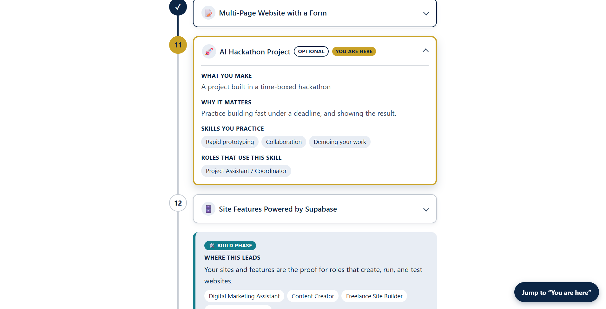

# Your Journey

A student-facing roadmap for the **AI and Digital Skills** bootcamp, a 24-week virtual course for adult learners. It shows the course as a vertical timeline of 16 steps with a "You are here" marker, so students who lose focus mid-course can see how far they have come and what the finish looks like.

**Live site:** https://jcsmileyjr.github.io/student-journey-roadmap/

Open `index.html` in a browser to run it locally. There are no build tools, no frameworks, and no server.

## Goals

- Help students keep their motivation through the middle of the course by making progress and the finish line visible.
- Show that every step builds something they can show to others.
- Serve as readable teaching code: one data array, plain state variables, one render function, and event handling.

## Who it is for

- **Students** using the roadmap to see where they are in the course.
- **The instructor**, who owns the content and sets the current step for each cohort.
- **Beginners** reading the code, which is projected and walked through in class.

## For the instructor

### Set the current step

- Use the **Set the current step** dropdown at the bottom of the page. It updates the address bar to something like `?step=11`. Copy that link and share it with the cohort.
- Or open a link directly, for example `https://jcsmileyjr.github.io/student-journey-roadmap/?step=11`.
- Or change the default in `journey-data.js`: `let currentStepId = 11;`

The address bar may not update when `index.html` is opened straight from disk. Use the hosted page when you want shareable links.

### Edit the content

All course text lives in `journey-data.js`: `journeySteps`, `journeyPhases`, and `rolesNote`. A field guide sits at the top of that file.

- If you add or renumber steps, update the step ids, each phase's `stepIds` range, `currentStepId`, and the icon map (`stepIcons`) in `script.js`.
- Roles are starting points, not promises. Keep the wording honest.
- Leave `exampleWork` as `null` until a student has given explicit consent.

## How the code is organized

| File | Role |
|---|---|
| `journey-data.js` | Data and state: steps, phases, `currentStepId`, `expandedStepId` |
| `script.js` | `renderJourney()`, click handling, step picker, motion, keyboard navigation |
| `style.css` | Mobile-first single-column layout, status styles, motion |
| `index.html` | Page shell |
| `reference/` | Static mockup of the card designs |
| `docs/` | Design notes, such as `aesthetics_updates.md` |

Five pieces to point out when teaching:

1. **Data layer:** `journeySteps` and `journeyPhases`.
2. **State:** `currentStepId` is progress (set by the instructor) and `expandedStepId` is navigation (which card is open).
3. **Render function:** `renderJourney()` builds the whole timeline from the data and state, on load and after every click.
4. **Event handling:** one delegated click listener on the timeline.
5. **Styling:** one consistent layout at every screen size.

## Features

- Timeline of 16 steps with completed, current, and upcoming states, an optional-step tag, and a two-tone line showing progress.
- Expandable cards with what you make, why it matters, skills, roles, and sub-steps.
- "Where this leads" blocks after each phase, with roles and paths.
- Progress count, milestone messages, expand/collapse all, and a "Jump to You are here" button.
- A celebration when the instructor moves the step forward, and a trophy that lights up near the finish.
- Arrow-key, Home, and End navigation between cards.

## Design rules

- Palette: navy, gold, teal, white, gray, and a light tint. White text on navy, navy text on gold, never white on gold. Gold is reserved for "You are here".
- Single column at every screen size, no horizontal scrolling at 360px.
- Accessibility: real buttons with `aria-expanded`, `aria-current` on the current step, a visible focus outline, and `prefers-reduced-motion` support.

## Out of scope

Backend, login, saved progress, a Previous/Next stepper, dark mode, and external fonts.

## Status

Aesthetics phases 1 to 5 are implemented. The sticky phase navigation bar is deferred. See `docs/aesthetics_updates.md`.
